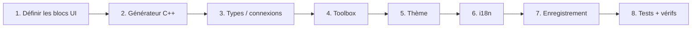

<div align="center">


# Ajouter une catégorie « Servomoteur »

</div>

Guide pas à pas pour ajouter une **nouvelle catégorie de blocs** dans µcBlockly v3 (Blockly 13), illustré avec **Servomoteur**.  
À adapter pour toute autre catégorie matérielle (capteur, afficheur, etc.).

> **Chemin recommandé** : pack runtime sans rebuild — [AJOUTER_EXTENSION.md](./AJOUTER_EXTENSION.md) et [`extensions/servo/`](../extensions/servo/).  
> Le guide ci-dessous est l’**intégration manuelle dans le noyau** (rebuild) si vous en avez besoin.

Complète [ARCHITECTURE.md](./ARCHITECTURE.md), [CONTRIBUTING.md](./CONTRIBUTING.md) et [TYPES_ET_COMPATIBILITES.md](./TYPES_ET_COMPATIBILITES.md).

---

## Vue d’ensemble du flux



| Étape | Fichiers principaux | Rôle |
|-------|---------------------|------|
| 1 | `src/categories/blockly/servo.ts` | Forme des blocs (champs, connexions) |
| 2 | `src/generators/arduino/blocks/servo.ts` | Code Arduino émis |
| 3 | `src/generators/arduino/block_types/servo.ts` | Types de sortie / checks |
| 4 | `src/toolbox.ts` | Entrée dans la boîte à outils |
| 5 | `src/options.ts` | Couleurs catégorie / blocs |
| 6 | `src/languages/*` | Libellés (CAT_*, tooltips, etc.) |
| 7 | `index` catégories + `generators/arduino.ts` + `block_types/index.ts` + `locale.ts` | Brancher le tout |
| 8 | `tests/`, `npm run lint|test|check-translations` | Qualité |

Convention de noms recommandée :

| Élément | Exemple |
|---------|---------|
| Préfixe type de bloc | `servo_`… (`servo_write`, `servo_attach`, …) |
| Style Blockly | `servo_blocks` / `servo_category` |
| Clé toolbox | `CAT_SERVO` |
| Fichiers | `servo.ts` partout (même nom de catégorie) |

---

## 0. Concevoir la catégorie (avant de coder)

Décider le périmètre minimal, par ex. :

| Type de bloc | Genre | Entrées / champs | Code Arduino attendu |
|--------------|-------|------------------|----------------------|
| `servo_attach` | statement | pin PWM | `#include <Servo.h>` + `Servo s_X;` + `s_X.attach(pin)` dans `setup` |
| `servo_write` | statement | pin + angle (0–180) | `s_X.write(angle);` |
| `servo_write_microseconds` | statement | pin + µs | `s_X.writeMicroseconds(us);` |
| `servo_read` | value → `int` | pin | `s_X.read()` |
| `servo_detach` | statement | pin | `s_X.detach();` |

Points de conception :

- **Broches** : réutiliser `dropdownPWM` des profils (`src/boards.ts`) — les servos classiques vont sur des pins PWM.
- **Objets C++** : un `Servo` par broche (`Servo servo_9;`) pour éviter les collisions de tags `addDefinition` / `addSetup`.
- **Attach automatique** : soit un bloc `servo_attach` explicite, soit `write` qui appelle `attach` en `setup` (plus simple pour débutants). Ce guide suppose **attach implicite** dans le générateur de `servo_write` / `servo_read`.

---

## 1. Définir les blocs (UI)

**Créer** `src/categories/blockly/servo.ts`.

S’inspirer de `board.ts` (dropdowns PWM) et `colour.ts` (structure `defineXxxBlocks`).

```ts
// Esquisse — à compléter (en-tête GPL + @packageDocumentation)
import * as Blockly from "blockly";
import { getBlocklyMsgOr } from "./shared";
// Réutiliser le helper de pins PWM de board.ts, ou le factoriser :
// import { getPinDropdown } from "./board"; // si exporté

export const defineServoBlocks = (): void => {
  if (!Blockly.Blocks["servo_write"]) {
    Blockly.Blocks["servo_write"] = {
      init(this: Blockly.Block) {
        this.appendDummyInput()
          .appendField(getBlocklyMsgOr("SERVO_WRITE", "servo write"))
          .appendField(
            new Blockly.FieldDropdown(() => /* getPinDropdown("dropdownPWM") */ [["9", "9"]]),
            "PIN",
          );
        this.appendValueInput("ANGLE")
          .setCheck("Number")
          .appendField(getBlocklyMsgOr("SERVO_ANGLE", "angle"));
        this.setPreviousStatement(true, null);
        this.setNextStatement(true, null);
        this.setStyle("servo_blocks");
        this.setTooltip(getBlocklyMsgOr("SERVO_WRITE_TOOLTIP", ""));
        this.setHelpUrl(getBlocklyMsgOr("SERVO_WRITE_HELPURL", ""));
      },
    };
  }
  // … servo_read, servo_detach, etc.
};
```

Bonnes pratiques UI :

- Toujours `getBlocklyMsgOr("CLE", "fallback anglais")` pour les textes.
- `setStyle("servo_blocks")` (déclaré à l’étape 5).
- Pour les angles : shadow `math_number` avec `NUM: 90` (déclaré dans la toolbox, étape 4).
- Si le champ PIN doit se rafraîchir au changement de carte : l’ajouter dans `BLOCK_PIN_DROPDOWN` / `refreshBoardPinDropdowns` de `board.ts` (même pattern que `board_base_inout_analog_write`).

**Enregistrer** dans `src/categories/blockly/index.ts` :

1. `import { defineServoBlocks } from "./servo";`
2. Appeler `defineServoBlocks();` dans `defineBlocklyArduinoCompatBlocks()`.
3. Réexporter `defineServoBlocks` si besoin.

Le noyau appelle déjà `defineAllTypedVariableBlocks()` → `defineBlocklyArduinoCompatBlocks()` depuis `src/core/register.ts` : **pas besoin de toucher `register.ts`** si vous branchez ici.

---

## 2. Générer le code Arduino

**Créer** `src/generators/arduino/blocks/servo.ts`.

API utile du générateur (`ArduinoGenerator`) :

| Méthode | Usage servo |
|---------|-------------|
| `addInclude(tag, code)` | `#include <Servo.h>` (une fois) |
| `addDefinition(tag, code)` | `Servo servo_9;` |
| `addSetup(tag, code)` | `servo_9.attach(9);` |
| `valueToCode(block, "ANGLE", Order.ASSIGNMENT)` | expression angle |
| `statementToCode` | non requis pour write simple |

```ts
import type { Block } from "blockly/core";
import type { ArduinoGenerator } from "../arduino_generator";
import { Order } from "../arduino_generator";

function ensureServo(generator: ArduinoGenerator, pin: string): string {
  const varName = `servo_${pin}`;
  generator.addInclude("servo", "#include <Servo.h>");
  generator.addDefinition(`servo_obj_${pin}`, `Servo ${varName};`);
  generator.addSetup(`servo_attach_${pin}`, `${varName}.attach(${pin});`);
  return varName;
}

export function servo_write(block: Block, generator: ArduinoGenerator): string {
  const pin = block.getFieldValue("PIN");
  const angle =
    generator.valueToCode(block, "ANGLE", Order.ASSIGNMENT) || "0";
  const servo = ensureServo(generator, pin);
  return `${servo}.write(${angle});\n`;
}

export function servo_read(block: Block, generator: ArduinoGenerator): [string, Order] {
  const pin = block.getFieldValue("PIN");
  const servo = ensureServo(generator, pin);
  return [`${servo}.read()`, Order.ATOMIC];
}
```

**Enregistrer** dans `src/generators/arduino.ts` :

```ts
import * as servo from "./arduino/blocks/servo";
// …
const generators = {
  // …
  ...servo,
};
```

Les exports nommés (`export function servo_write`) doivent **correspondre exactement** aux `type` des blocs Blockly.

---

## 3. Types et compatibilité des connexions

**Créer** `src/generators/arduino/block_types/servo.ts` :

```ts
export const SERVO_BLOCK_TYPES = {
  // statements : pas d’entrée dans le registre (pas de setOutput)
  servo_read: "int", // valeur 0–180
} as const;
```

**Merger** dans `src/generators/arduino/block_types/index.ts` :

```ts
import { SERVO_BLOCK_TYPES } from "./servo";

export const BLOCK_TYPES = {
  // …
  ...SERVO_BLOCK_TYPES,
} as const;
```

`applyBlockTypesFromRegistry()` (appelé au boot du noyau) appliquera `setCheck` / `setOutput` selon ce registre.  
Détails : [TYPES_ET_COMPATIBILITES.md](./TYPES_ET_COMPATIBILITES.md).

Pour un statement (`servo_write`), aucune entrée n’est nécessaire dans `SERVO_BLOCK_TYPES`.  
Pour une entrée valeur (`ANGLE`), le `setCheck("Number")` côté définition de bloc + shadows suffit en général ; le checker strict (`strictConnectionChecker`) respecte la matrice `TYPE_COMPATIBILITY`.

---

## 4. Toolbox

Dans `src/toolbox.ts`, ajouter une catégorie dans `basic_toolbox` (près de `CAT_BOARD` / `CAT_COLOR`) :

```ts
{
  kind: "category",
  name: "CAT_SERVO",
  categorystyle: "servo_category",
  contents: [
    {
      kind: "block",
      type: "servo_write",
      inputs: {
        ANGLE: {
          shadow: { type: "math_number", fields: { NUM: 90 } },
        },
      },
    },
    { kind: "block", type: "servo_read" },
    // …
  ],
},
```

Notes :

- `name: "CAT_SERVO"` est une **clé i18n** (traduite via `Blockly.Msg` / fichiers de langue), pas le libellé final.
- Si vous filtrez certaines catégories (ex. `getToolboxWithoutBoardCategory`), décider si Servo doit rester visible hors carte — en pratique **oui**, car les pins viennent du profil courant.

---

## 5. Thème (couleurs)

Dans `src/options.ts`, étendre le thème comme pour `board` / `libre` :

1. Constantes `SERVO_CATEGORY_STYLE` / `SERVO_BLOCK_STYLE` (couleur distincte, bon contraste).
2. Dans `extendThemeWithLibre` (ou renommer / généraliser la fonction) :
   - `categoryStyles.servo_category`
   - `blockStyles.servo_blocks`
3. Respecter les thèmes noir & blanc / hacker (même logique que `board` : noir en `blackWhite`).

Sans cette étape : warnings Blockly « Missing style » et catégorie sans couleur.

---

## 6. Internationalisation (i18n)

### 6.1 Nom de catégorie (`CAT_SERVO`)

Ajouter dans **chaque** fichier `src/languages/{en,fr,es,ar}.ts` :

```ts
CAT_SERVO: "Servomotor", // en
CAT_SERVO: "Servomoteur", // fr
// es, ar…
```

### 6.2 Messages des blocs

Deux options (comme le reste du dépôt) :

| Option | Quand | Fichiers |
|--------|--------|----------|
| **A. Fichier dédié** (recommandé, comme board/array) | Beaucoup de clés `SERVO_*` | `src/languages/servo_messages.ts` + `mergeServoMessages(lang)` dans `src/core/locale.ts` |
| **B. Clés custom** | Peu de clés | Entrées dans `fr.ts` / `en.ts` / … **et** dans `CUSTOM_KEYS` de `scripts/check-translations.cjs` |

Exemple option A :

```ts
// servo_messages.ts
export const SERVO_MESSAGES = {
  en: {
    SERVO_WRITE: "set servo pin",
    SERVO_ANGLE: "to angle",
    SERVO_WRITE_TOOLTIP: "Write an angle (0–180) to a servo on a PWM pin.",
    SERVO_WRITE_HELPURL: "",
    // …
  },
  fr: { /* … */ },
  es: { /* … */ },
  ar: { /* … */ },
};
```

Dans `locale.ts`, après `mergeBoardMessages(language)` :

```ts
mergeServoMessages(language);
```

### 6.3 Vérifier

```bash
npm run check-translations
```

Étendre le script si option A (parity des clés `SERVO_*` sur les 4 langues, comme `board_messages.ts`).

---

## 7. Pins et changement de carte

Si les blocs servo ont un champ `PIN` PWM :

1. Utiliser le même `getPinDropdown("dropdownPWM")` que `board.ts`.
2. Enregistrer le type de bloc dans `BLOCK_PIN_DROPDOWN` (ex. `servo_write: "pwm"`).
3. `refreshBoardPinDropdowns(workspace)` est déjà appelé après chargement / changement de carte — les menus se mettront à jour.

Profils PWM : `src/boards.ts` (`PWM` / `dropdownPWM` par carte).

---

## 8. Tests

Ajouter `tests/servo-generator.test.ts` (pattern `tests/generators.test.ts`) :

- Workspace minimal avec `servo_write` (pin 9, angle 90).
- Assert que le code contient `#include <Servo.h>`, `Servo servo_9`, `attach(9)`, `write(90)`.
- Cas `servo_read` : expression et type.

```bash
npm run test
```

Optionnel : test de connexion (angle non numérique refusé si checker strict).

---

## 9. Qualité et build

Dans l’ordre :

```bash
npm run lint
npm run check-translations
npm run test
npm run build:lib
npm run dev   # vérifier toolbox + génération visuelle
```

Puis, si vous maintenez l’inventaire :

```bash
npm run extract-functions
```

---

## 10. Checklist récapitulative

- [ ] `categories/blockly/servo.ts` + appel dans `index.ts`
- [ ] `generators/arduino/blocks/servo.ts` + spread dans `generators/arduino.ts`
- [ ] `block_types/servo.ts` + merge dans `block_types/index.ts`
- [ ] Entrée `CAT_SERVO` dans `toolbox.ts` (+ shadows)
- [ ] Styles `servo_category` / `servo_blocks` dans `options.ts`
- [ ] `CAT_SERVO` dans `en` / `fr` / `es` / `ar`
- [ ] Messages `SERVO_*` (+ `mergeServoMessages` ou `CUSTOM_KEYS`)
- [ ] Pins PWM + `refreshBoardPinDropdowns` si besoin
- [ ] Test(s) générateur
- [ ] `lint` / `check-translations` / `test` / build OK
- [ ] (Optionnel) Doc wiki / README si la catégorie devient « officielle »

---

## 11. Pièges fréquents

| Symptôme | Cause probable |
|----------|----------------|
| Bloc absent de la toolbox | Oubli dans `toolbox.ts` ou mauvais `type` |
| « Missing style » | `options.ts` sans `servo_blocks` / `servo_category` |
| Texte `CAT_SERVO` brut | Clé absente des fichiers de langue |
| Code généré sans `Servo` | Générateur non enregistré dans `arduino.ts` ou nom ≠ type de bloc |
| `#include` dupliqué / ordre bizarre | Tags `addInclude` / `addDefinition` différents par pin (voulu) vs même tag écrasé |
| Pin liste vide après changement de carte | Bloc non listé dans `BLOCK_PIN_DROPDOWN` |
| `check-translations` rouge | Clé manquante dans une langue ou pas dans `CUSTOM_KEYS` / fichier `*_messages` |

---

## 12. Périmètre hors noyau

- **Projet dérivé** (BlocklyDuino v3, démo custom) : si la toolbox est fournie par le host (`createUcBlockly({ toolbox })`), il faudra **aussi** ajouter la catégorie dans *sa* toolbox JSON — le noyau ne force pas `basic_toolbox`.
- **Conversion Blockly@rduino** : si d’anciens projets ont des blocs servo sous d’autres noms, étendre `scripts/lib/rduino-block-map.mjs` (voir [CONVERT_RDUINO.md](./CONVERT_RDUINO.md)).

---

## Voir aussi

- [ARCHITECTURE.md](./ARCHITECTURE.md) — « Where to change what »
- [CONTRIBUTING.md](./CONTRIBUTING.md) — qualité avant PR
- [TYPES_ET_COMPATIBILITES.md](./TYPES_ET_COMPATIBILITES.md) — typage
- [KERNEL.md](./KERNEL.md) — surface publique (`createUcBlockly`)
