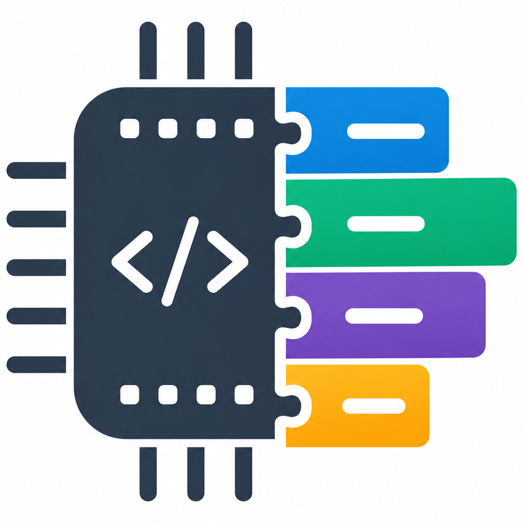
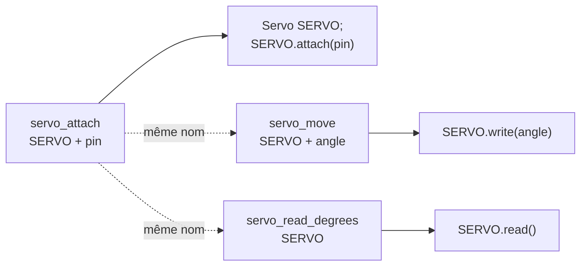
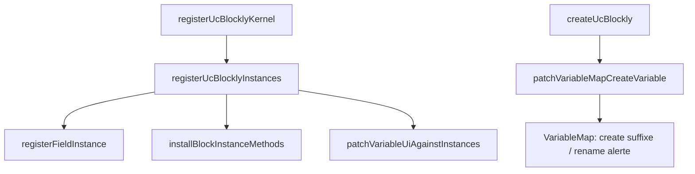

<div align="center">



# Instances nommées — µcBlockly

</div>

Ce document décrit le modèle **instance** (composants nommés : Servo, I2C, …), héritier de Blockly@rduino / Ardublockly, porté sur Blockly 13.

Complète [KERNEL.md](./KERNEL.md) (exports noyau), [AJOUTER_EXTENSION.md](./AJOUTER_EXTENSION.md) (packs runtime) et [TYPES_ET_COMPATIBILITES.md](./TYPES_ET_COMPATIBILITES.md) (typage des entrées).

---

## 1. Pourquoi des instances ?

Une **variable** Blockly stocke une valeur (`int`, `float`, …).  
Une **instance** désigne un **objet matériel / logiciel** partagé entre plusieurs blocs : un servomoteur `SERVO`, un bus `I2C1`, etc.

| | Variable | Instance |
|--|----------|----------|
| Rôle | Valeur typée | Identifiant d’objet (Servo, capteur…) |
| Stockage | `VariableMap` Blockly | Champs `FieldInstance` sur les blocs (pas de map séparée) |
| UI | Menu variables | Dropdown + « nouvelle / renommer » |
| Code généré | `item`, `compteur`, … | Nom C++/Python de l’objet (`SERVO.attach(…)`) |

Exemple servo :



Sans instance nommée, chaque bloc devrait répéter la broche ou inventer son propre `Servo servo_9;` — fragile dès qu’il y a plusieurs périphériques du même type.

---

## 2. Concepts

### Type d’instance (`instanceType`)

Chaîne logique qui regroupe les noms d’un même genre d’objet : `"Servo"`, `"I2C"`, …

- Les menus `FieldInstance` d’un type ne listent que les noms de **ce** type.
- Deux types différents peuvent théoriquement partager un libellé, mais **les noms d’instances et de variables partagent un seul espace de noms** (voir §5).

### Nom d’instance

Texte libre (ex. `SERVO`, `brasGauche`). Le générateur le transforme en identifiant valide (`servoCppName` dans le pack servo : caractères non alphanumériques → `_`).

### Bloc de configuration vs blocs d’usage

| Rôle | Exemple servo | Comportement |
|------|---------------|--------------|
| **Configuration / attach** | `servo_attach` | Crée l’objet (`#include`, définition, `setup`) |
| **Usage** | `servo_move`, `servo_detach`, … | Réutilise le nom ; avertit si aucun autre bloc ne référence cette instance |

L’avertissement d’usage passe par `updateInstancePresenceWarning(block, "SERVO_NAME", "Servo")`.

---

## 3. Architecture du code

```
src/instances/
├── index.ts            # API publique + registerUcBlocklyInstances()
├── field_instance.ts   # FieldInstance (dropdown Blockly)
├── instances.ts        # Scan workspace, rename, noms uniques, collisions
├── block_helpers.ts    # updateInstancePresenceWarning, patch Block.prototype
├── messages.ts         # i18n NEW/RENAME/COMPONENT_WARN/collisions
└── name_guard.ts       # Patch UI Variables (complément VariableMap)
```

Enregistrement : `registerUcBlocklyKernel()` → `registerUcBlocklyInstances()` (idempotent).



Les noms **ne sont pas** stockés dans un registre séparé : ils sont **reconstruits** en parcourant les `FieldInstance` du workspace. Compatible avec la sérialisation JSON Blockly (le nom est la valeur du champ).

---

## 4. `FieldInstance`

Dropdown dérivé de `FieldDropdown`, enregistré comme `"field_instance"`.

### Constructeur

```ts
new FieldInstance(
  instanceType,   // "Servo"
  instanceName,   // "SERVO" | null → nom auto
  uniqueName,     // true : forcer un nom unique à la sortie du flyout
  lockNew,        // true : masquer « nouvelle instance »
  lockRename,     // true : masquer « renommer »
)
```

Équivalent JSON (si le champ est sérialisé) : `instanceType`, `instanceName`, `uniqueName`, `lockNew`, `lockRename`.

### Menu

1. Liste des noms existants du même `instanceType` (triés)
2. Entrées i18n « renommer » / « nouvelle instance » (sauf `lock*`)
3. Prompt Blockly pour saisir le nom ; collision avec une **variable** → alerte + nouveau prompt

### Init du modèle

- Nom vide → `generateUniqueName(workspace)` (`i`, `j`, … puis `i2`, …)
- `uniqueName` hors flyout → `convertToUniqueNameBlock`
- Sinon, si le nom n’existe pas encore pour le type et qu’un autre existe → réutilise le premier trouvé

### Extensions (`defineBlocks(ctx)`)

Le loader injecte `FieldInstance`, `Instances`, `updateInstancePresenceWarning` — **pas d’import** de `µcBlockly` dans le pack. Voir [AJOUTER_EXTENSION.md](./AJOUTER_EXTENSION.md) et [`extensions/servo/blocks.js`](../extensions/servo/blocks.js).

---

## 5. Espace de noms partagé avec les variables

Un même identifiant **ne peut pas** être à la fois une variable et une instance (casse ignorée).

| Action | Comportement |
|--------|--------------|
| Nouvelle instance / nom unique | `convertToUniqueName` / `convertToUniqueNameBlock` suffixe (`SERVO` → `SERVO_1`) si collision |
| Renommer une instance vers une variable | Alerte + re-prompt |
| Créer une variable (programmatique) en collision | Suffixe automatique via `patchVariableMapCreateVariable` |
| Renommer une variable vers une instance | Alerte (pas d’exception) + re-prompt ; le renommage est annulé |

Helpers :

- `findVariableNameCollision(name, workspace)`
- `findInstanceNameCollision(name, workspace)`

Messages : `INSTANCE_NAME_COLLIDES_WITH_VARIABLE`, `VARIABLE_NAME_COLLIDES_WITH_INSTANCE` (`src/instances/messages.ts`, fusionnés dans `Blockly.Msg`).

> **Note technique** : l’UI Blockly appelle `VariableMap.renameVariable` en interne (bundle compressé). Le garde-fou fiable est donc le patch de la **map**, pas seulement `Blockly.Variables.renameVariable`.

---

## 6. API `Instances` (miroir historique)

Namespace `Instances` / fonctions exportées depuis `µcBlockly/core` :

| API | Rôle |
|-----|------|
| `allInstancesOf(type, workspace)` | Noms uniques d’un type (ou tous si `type` omis) |
| `allInstances(workspace)` | Tous les noms d’instances |
| `getAnyInstanceOf(type, workspace)` | Premier nom trouvé |
| `isInstancePresent(name, type, block)` | Un **autre** bloc référence déjà ce nom (usage → config) |
| `renameInstance(old, new, type, workspace)` | Met à jour tous les champs du type |
| `generateUniqueName(workspace)` | Nom court libre vs variables + instances |
| `convertToUniqueName` / `convertToUniqueNameBlock` | Suffixe `_1`, `_2`, … |
| `getInstancesFromBlock(block, type?)` | Noms sur un bloc |
| `INSTANCE_NAME_TYPE` | Token `"INSTANCE"` (catégorie de nom) |

Sur `Block.prototype` (après enregistrement) :

- `block.getInstances(opt_type?)`
- `block.renameInstance(old, new, type)`

---

## 7. Génération de code

Le générateur lit le champ (souvent `"SERVO_NAME"`) et émet le nom comme identifiant C++ / MicroPython.

Pattern recommandé (pack servo) :

1. **Attach** : `addInclude` + `addDefinition` + `addSetup` (tags stables dérivés du nom)
2. **Usage** : uniquement l’appel (`name.write(…)`) — l’objet est déjà déclaré

Ne pas régénérer `Servo X;` sur chaque bloc d’usage.

---

## 8. Checklist contributeur (nouveau périphérique à instances)

1. Choisir un `instanceType` stable (`"Servo"`, `"Ultrasonic"`, …)
2. Bloc **attach / config** avec `FieldInstance` + entrées typées (souvent `int` via `getBlocklyCompatibleChecks("int")` + `enforceIntOnlyValueInputs`)
3. Blocs d’**usage** avec le même type + `onchange` → `updateInstancePresenceWarning`
4. Générateurs : nom → identifiant ; side-effects seulement sur le bloc config
5. i18n pack : libellés blocs + éventuellement s’appuyer sur les messages noyau d’instances
6. Tests : scan `allInstancesOf`, rename, collision variable (voir `tests/instances.test.ts`)

Référence complète : [`extensions/servo/`](../extensions/servo/).

---

## 9. Fichiers et liens

| Ressource | Contenu |
|-----------|---------|
| `src/instances/` | Implémentation noyau |
| `tests/instances.test.ts` | Tests unitaires |
| [KERNEL.md](./KERNEL.md) | Exports `FieldInstance` / `Instances` |
| [AJOUTER_EXTENSION.md](./AJOUTER_EXTENSION.md) | Contrat `defineBlocks(ctx)` |
| [extensions/README.md](../extensions/README.md) | Packs runtime |
| Blockly@rduino / Ardublockly | Modèle historique `Blockly.Instances` / `FieldInstance` |
