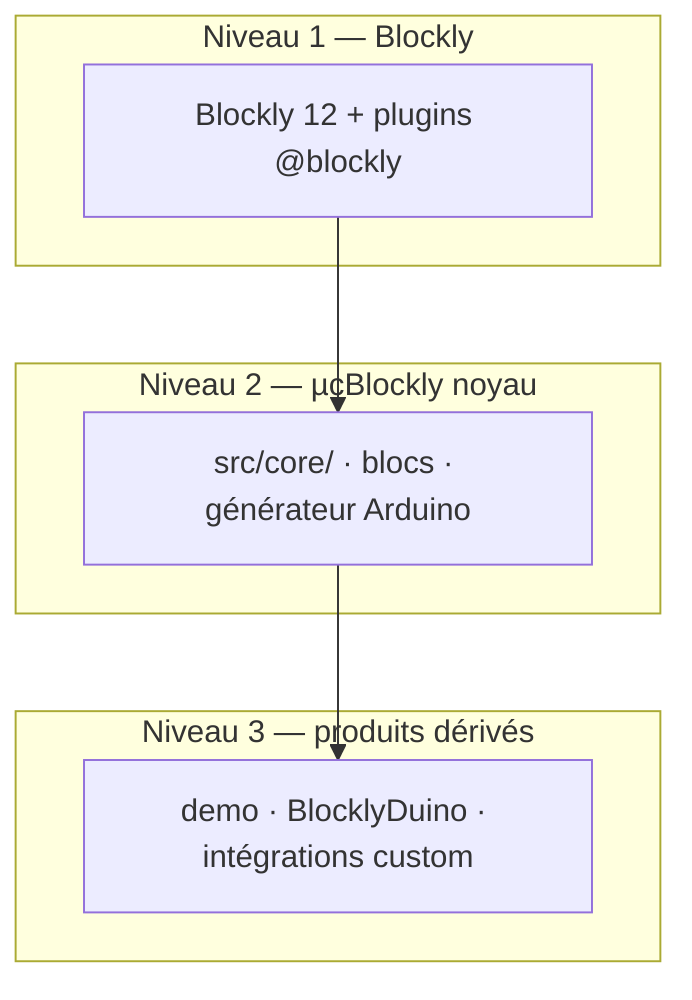

<div align="center">


# µcBlockly — noyau (KERNEL)

</div>

Ce document décrit la **surface publique** du noyau embeddable et ce qui reste **interne / démo**.  
Complète [ARCHITECTURE.md](./ARCHITECTURE.md) (vue contributeur) et [INTEGRATION_DEPOT.md](./INTEGRATION_DEPOT.md) (intégration dans un autre dépôt).

---

## 1. Pile à trois niveaux



| Niveau | Rôle | Exemple |
|--------|------|---------|
| **Blockly** | Moteur visuel générique | workspace, toolbox, sérialisation |
| **µcBlockly (noyau)** | Blocs Arduino typés, générateur C++, API embed | `createUcBlockly()` |
| **Produit dérivé** | UI métier, cartes, déploiement | démo µcBlockly, BlocklyDuino |

Le noyau **ne doit pas** embarquer Monaco, la topbar démo, ni les `getElementById` du shell.

---

## 2. Surface publique (`µcBlockly` / `µcBlockly/core`)

Point d’entrée TypeScript : `src/core/index.ts` → `build/src/core/index.js`.

### API principale

| Export | Description |
|--------|-------------|
| `createUcBlockly(container, options)` | Injecte Blockly + générateur dans un conteneur DOM |
| `registerUcBlocklyKernel(options?)` | Enregistrement idempotent des blocs / types (appelé par `createUcBlockly`) |
| `applyUcBlocklyLocale(language)` | Locale Blockly + messages µcBlockly |
| `sanitizeSerializedWorkspaceState(state)` | Nettoie les coordonnées NaN avant load/save |

### Types

| Type | Usage |
|------|--------|
| `UcBlocklyOptions` | `toolbox`, `language`, `theme`, `media`, `enforcers`, `plugins`, `onCodeChange`, … |
| `UcBlocklyInstance` | `workspace`, `getCode()`, `saveWorkspace()`, `loadWorkspace()`, `resize()`, `dispose()` |
| `UcBlocklyEnforcerOptions` | `strictTypes`, `programStructure`, `strictConnectionChecker` |
| `UcBlocklyPluginOptions` | `backpack`, `minimap`, `workspaceSearch`, … |
| `UcBlocklyWorkspaceManagerOptions` | Config avancée (lifecycle sans shell) |

### Classes avancées (embed / produits)

| Export | Description |
|--------|-------------|
| `UcBlocklyWorkspaceManager` | Cycle de vie workspace (reboot, plugins, persistence) sans DOM démo |
| `UcBlocklyPluginHost` | Init / dispose des plugins Blockly configurables |
| `DEFAULT_UCBLOCKLY_*` / `resolve*Options()` | Valeurs par défaut enforceurs & plugins |

### Réexports utiles

| Export | Source |
|--------|--------|
| `arduinoGenerator` | Génération C++ |
| `basic_toolbox`, `getToolboxForCurrentBoard`, `getToolboxWithoutBoardCategory` | Toolbox JSON |
| `ToolboxConfiguration` | Type toolbox |

### Exemple minimal

```ts
import { createUcBlockly, basic_toolbox } from "µcBlockly/core";

const editor = createUcBlockly(document.getElementById("editor")!, {
  toolbox: basic_toolbox,
  language: "fr",
  enforcers: { strictTypes: true, programStructure: true },
  plugins: { minimap: false, workspaceSearch: true },
  onCodeChange: (code) => console.log(code),
});
```

---

## 3. Surface interne (ne pas importer depuis un produit dérivé)

| Zone | Fichiers | Pourquoi interne |
|------|----------|------------------|
| **Shell démo** | `src/demo/blockly_application_shell.ts`, `src/index.ts` | Menus HTML, Monaco, URL, sessionStorage |
| **Compat re-export** | `src/blockly_application_type.ts` | Alias vers le shell démo |
| **Éditeur Monaco** | `src/code_editor.ts` | ~3 Mo, panel C++ de la démo |
| **Layout flex** | `src/workspace_flex.ts`, `src/workspace_layout_utils.ts`, `src/workspace_resize.ts` | Panneaux redimensionnables démo |
| **A11y coque** | `src/shell_a11y.ts`, `src/a11y_labels.ts` | HTML `public/index.html` |
| **Thème UI coque** | `src/ui_palette_theme.ts` | Sync CSS topbar ↔ thème Blockly |
| **Debug démo** | `src/block_debug_context_menu.ts` | Menu contextuel développeur |

Ces modules peuvent être importés **dans le dépôt µcBlockly** pour la démo ; un produit tiers doit s’appuyer sur `./core` uniquement.

---

## 4. Noyau vs démo — dépendances

```
src/core/
  create_ucblockly.ts      ← API embed
  register.ts              ← blocs / registry
  locale.ts                ← i18n noyau
  ucblockly_workspace_manager.ts
  ucblockly_plugins.ts
  default_options.ts

src/categories/blockly/    ← définitions de blocs (public implicite via kernel)
src/generators/arduino/    ← générateur (public via arduinoGenerator)
src/toolbox.ts             ← toolbox JSON
src/languages/             ← messages
src/boards.ts              ← profils cartes

src/demo/                  ← INTERNe (exemple embed + shell)
src/index.ts               ← INTERNe (webpack main)
```

---

## 5. Builds

| Script | Produit | Contenu |
|--------|---------|---------|
| `npm run build:core` | `build/src/core/` (+ deps compilées) | **Lib TypeScript noyau** — sans `index.ts`, sans Monaco |
| `npm run build:core:bundle` | `dist/core/` | **Page embed statique** — JS + `index.html` + `media/`, **sans Monaco** |
| `npm run build:demo` | `dist/bundle/` | Démo complète — Monaco + `public/index.html` |
| `npm run build` | les deux | `build:demo` puis `build:core:bundle` |
| `npm run build:lib` | `build/` | Compile **tout** `src/` (dev local, inclut démo) |
| `npm run dev` | `build/` (dev server) | Démo hot-reload |
| `npm run dev:embed` | `dist/core/` (port 8081) | Exemple embed noyau seul |

### Exports npm (`package.json`)

| Chemin | Cible |
|--------|--------|
| `"."` / `"./core"` | `build/src/core/index.js` — **noyau** |
| `"./demo"` | `build/src/index.js` — point d’entrée démo (Monaco, shell) |

Artefact navigateur embed : servir le dossier `dist/core/` (pas `dist/bundle/`).

---

## 6. Options configurables (rappel)

Voir `src/core/types.ts` et `src/core/default_options.ts`.

**Enforceurs** (défauts : strictTypes ✓, programStructure ✓, strictConnectionChecker ✗) :

```ts
enforcers: {
  strictTypes: true,
  programStructure: true,
  strictConnectionChecker: false,
}
```

**Plugins workspace** (via `UcBlocklyPluginHost` / `plugins` dans `createUcBlockly`) :

```ts
plugins: {
  backpack: true,
  minimap: true,
  workspaceSearch: true,
  contentHighlight: false,
  // …
}
```

**Toolbox** : obligatoire dans `UcBlocklyOptions.toolbox` ; utiliser `basic_toolbox` ou une variante filtrée (`getToolboxWithoutBoardCategory`, etc.).

---

## 7. Évolutions prévues (roadmap)

| Priorité | Sujet | État |
|----------|--------|------|
| P0 | `createUcBlockly(container)` | ✅ |
| P0 | Séparer demo / export npm | ✅ |
| P1 | Workspace vs shell | ✅ |
| P1 | Options plugins / enforceurs | ✅ |
| P2 | Build core sans Monaco | ✅ (`build:core`, `dist/core/`) |
| P2 | Ce document KERNEL.md | ✅ |
| P3 | Publication npm (`private: false`, exports) | À faire |

---

## 8. Liens

- [ARCHITECTURE.md](./ARCHITECTURE.md) — layout `src/`, conventions contributeur  
- [INTEGRATION_DEPOT.md](./INTEGRATION_DEPOT.md) — iframe, submodule, API embed  
- [ACCESSIBILITY.md](./ACCESSIBILITY.md) — accessibilité (démo + blocs)
