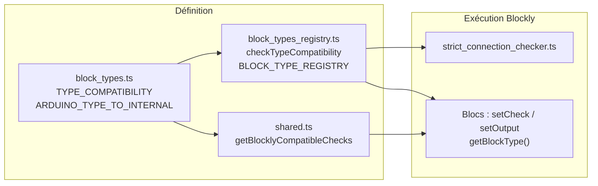

<div align="center">


# Types et compatibilités — µcBlockly

</div>

Ce document décrit le système de typage des blocs : types internes, règles de connexion, pont avec les checks Blockly, et bloc de cast `variables_cast`.

## Vue d’ensemble

Le typage repose sur **trois couches** :



| Couche | Fichier | Rôle |
|--------|---------|------|
| Règles pures | `src/generators/arduino/block_types.ts` | Matrice `TYPE_COMPATIBILITY`, types de cast, helpers `getCompatibleTypes` / `isTypeCompatible` |
| Registre & vérification | `src/generators/arduino/block_types_registry.ts` | Type par bloc (`BLOCK_TYPE_REGISTRY`), `checkTypeCompatibility` (alias Blockly ↔ types internes) |
| Checks Blockly | `src/categories/blockly/shared.ts` | `getBlocklyCompatibleChecks` : convertit un type µcBlockly en checks `setCheck` / `setOutput` |
| Application runtime | `src/generators/arduino/strict_connection_checker.ts` | Connection checker strict au-delà du checker Blockly par défaut |

Les **types internes** (µcBlockly) sont : `int`, `float`, `long`, `bool`, `string`, `char`, `null`.  
Ils ne correspondent pas toujours aux types C++ Arduino émis dans le code généré (ex. `byte`, `unsigned int`).

---

## Matrice `TYPE_COMPATIBILITY`

Définie dans `block_types.ts`. Format : `type_cible → [types_sources_acceptés]`.

La cible inclut toujours elle-même. Une connexion est valide si le type **source** (sortie du bloc enfiché) figure dans la liste de la cible.

| Type cible | Types sources acceptés | Remarque |
|------------|------------------------|----------|
| `int` | `int` | Pas de promotion depuis `float` (pas de perte de précision implicite) |
| `float` | `float`, `int` | Promotion implicite `int` → `float` |
| `long` | `long`, `int` | Entier long ; `int` accepté en entrée |
| `bool` | `bool` | |
| `string` | `string`, `char` | Un caractère peut alimenter une entrée texte |
| `char` | `char` | |
| `null` | `null` | Blocs sans valeur typée |

**Types exclus des menus variables** : `null`, `array` (les listes sont typées par leur contenu).

### Sentinelle `__NO_TYPE__` et listes vides

- **`__NO_TYPE__`** : type Blockly interne pour « pas encore typé » (variable non initialisée, liste vide, sortie de bloc sans inférence). Les connexions typées sont bloquées tant que le type n’est pas résolu.
- **Listes vides** : pas de valeurs `{0, 0}` par défaut ; avertissement utilisateur via `ARRAY_LIST_UNTYPED_WARNING` (`array_messages.ts`, `shared.ts`).
- **Génération** : si le type d’élément reste `__NO_TYPE__`, le générateur retombe sur `int` pour le C++ (`arduino_generator.ts`, `blocks/array.ts`).

Fonctions associées :

- `getCompatibleTypes(targetType)` — liste des sources compatibles pour une cible ;
- `isTypeCompatible(source, target)` — test booléen ;
- `getVariableTypeOptions()` — liste ordonnée des 11 types Arduino pour **tous** les menus déroulants ;
- `getArduinoTypeDropdownOptions()` — options Blockly (libellé + valeur), dans `variables.ts`.

---

## Liste centralisée des types Arduino (`ARDUINO_TYPE_KEYS`)

Une **seule** liste alimente tous les menus de type :

- `variables_set_init` (« mettre … au type … »)
- `variables_set_type` (« forcer le type de … »)
- `variables_cast` (« de type … »)
- arguments de procédures (`configure_standard_blocks.ts`)
- listes (`array.ts`)

| Constante / fonction | Fichier | Rôle |
|----------------------|---------|------|
| `ARDUINO_TYPE_KEYS` | `block_types.ts` | 11 clés dans l’ordre Blockly@rduino |
| `getVariableTypeOptions()` | `block_types.ts` | Retourne une copie de cette liste |
| `getArduinoTypeLabelKey()` | `block_types.ts` | Clé i18n `VAR_CAST_TYPE_*` |
| `getArduinoTypeDropdownOptions()` | `variables.ts` | Menu Blockly partagé |
| `ARDUINO_TYPE_TO_CPP` / `getCppTypeName()` | `block_types.ts` | Type C++ généré |
| `ARDUINO_TYPE_TO_INTERNAL` / `getInternalTypeForArduinoType()` | `block_types.ts` | Type pour les connexions |

Les libellés traduits utilisent uniquement les clés **`VAR_CAST_TYPE_*`** (fr, en, es, ar).

---

## Règles Blockly supplémentaires (`checkTypeCompatibility`)

`block_types_registry.ts` complète `isTypeCompatible` pour les **alias Blockly** :

| Situation | Compatible |
|-----------|------------|
| `bool` ↔ `Boolean` | oui |
| `string` ↔ `String` | oui |
| `char` → `string` / `String` | oui |
| `Colour` ↔ `String` / `string` | oui (blocs couleur) |
| `Number` → `int`, `float`, `long` | oui (ex. bloc nombre standard) |
| `int`, `float`, `long` → `Number` | oui |
| `Array` ↔ `array` | oui |

Toute autre paire passe par `isTypeCompatible` (matrice ci-dessus).

---

## Pont Blockly : `getBlocklyCompatibleChecks`

Dans `shared.ts`, convertit un type µcBlockly en tableau passé à `connection.setCheck()` ou `block.setOutput()`.

Enrichissements automatiques (mode **non strict**, par défaut) :

| Type interne présent | Checks Blockly ajoutés |
|----------------------|-------------------------|
| `bool` | `Boolean` |
| `int`, `float`, `long` | `Number` |
| `string` | `String`, `Colour` |
| `array` | `Array` |

**Mode strict** (`strict: true`) : utilisé notamment pour la définition de listes — seul `float` ajoute `Number`, pas `int`, afin de rejeter les blocs flottants sur une entrée entière stricte.

---

## Bloc `variables_cast`

Bloc valeur : `[entrée VALUE] de type [menu]`.  
Fichiers : définition `categories/blockly/variables.ts`, génération `generators/arduino/blocks/variables_typed.ts`.

- L’entrée `VALUE` accepte **tout** (`setCheck(null)`).
- La sortie est typée dynamiquement selon le menu via `getBlocklyCompatibleChecks(getInternalTypeForArduinoType(...))`.

### Menu (partagé avec les autres blocs)

| Clé `CAST_TYPE` | Libellé FR (clé i18n) | Mot-clé C++ généré | Type interne (connexions) |
|-----------------|------------------------|--------------------|---------------------------|
| `char` | `VAR_CAST_TYPE_CHAR` | `char` | `char` |
| `string` | `VAR_CAST_TYPE_STRING` | `String` | `string` |
| `bool` | `VAR_CAST_TYPE_BOOL` | `bool` | `bool` |
| `byte` | `VAR_CAST_TYPE_BYTE` | `byte` | `int` |
| `int` | `VAR_CAST_TYPE_INT` | `int` | `int` |
| `uint` | `VAR_CAST_TYPE_UINT` | `unsigned int` | `int` |
| `vint` | `VAR_CAST_TYPE_VINT` | `volatile int` | `int` |
| `long` | `VAR_CAST_TYPE_LONG` | `long` | `long` |
| `ulong` | `VAR_CAST_TYPE_ULONG` | `unsigned long` | `int` |
| `float` | `VAR_CAST_TYPE_FLOAT` | `float` | `float` |

Constantes : `ARDUINO_TYPE_KEYS`, `ARDUINO_TYPE_TO_INTERNAL`, `ARDUINO_TYPE_TO_CPP`, `getInternalTypeForArduinoType()` dans `block_types.ts`.  
Registre dynamique : `variables_cast: "__DYNAMIC__castType"` → fonction `castType` dans `block_types_registry.ts`.

Exemple de code généré : branchement d’un get `toto` avec cast `byte` → `(byte)(toto)`.

---

## Types par bloc (`BLOCK_TYPE_REGISTRY`)

Chaque bloc a un type statique (`"int"`, `"string"`, …) ou dynamique (`__DYNAMIC__nomFonction`) dans `generators/arduino/block_types/<catégorie>.ts`.  
Les fonctions dynamiques sont dans `DYNAMIC_TYPE_FUNCTIONS` (`block_types_registry.ts`).

Exemples :

- `variables_get_dynamic` → type de la variable lue ;
- `variables_cast` → `getInternalTypeForArduinoType(CAST_TYPE)` ;
- `math_number` → `int` ou `float` selon la valeur / le contexte.

`applyBlockTypesFromRegistry()` attache `getBlockType()` aux définitions Blockly au démarrage.

---

## Modifier les compatibilités

| Objectif | Fichier(s) |
|----------|------------|
| Nouvelle règle int/float/string… | `block_types.ts` → `TYPE_COMPATIBILITY` |
| Nouveau type de cast ou mapping | `block_types.ts` → `ARDUINO_TYPE_KEYS`, `ARDUINO_TYPE_TO_INTERNAL`, `ARDUINO_TYPE_TO_CPP` + libellés `languages/*.ts` (`VAR_CAST_TYPE_*`) |
| Alias Blockly (Number, Boolean…) | `block_types_registry.ts` → `checkTypeCompatibility` |
| Checks `setCheck` / `setOutput` | `shared.ts` → `getBlocklyCompatibleChecks` |
| Type d’un bloc spécifique | `block_types/<catégorie>.ts` + éventuellement `DYNAMIC_TYPE_FUNCTIONS` |

Après modification, vérifier :

```bash
npm run build:lib
npm run lint
npm run test
```

Et tester manuellement les connexions dans l’éditeur (flyout variables, cast, nombres, comparaisons).

---

## Voir aussi

- [ARCHITECTURE.md](./ARCHITECTURE.md) — organisation du dépôt ;
- [REPARTITION_FICHIERS.md](./REPARTITION_FICHIERS.md) — répartition `block_types` / `shared` / `variables` ;
- [CONTRIBUTING.md](./CONTRIBUTING.md) — guide contributeur.
